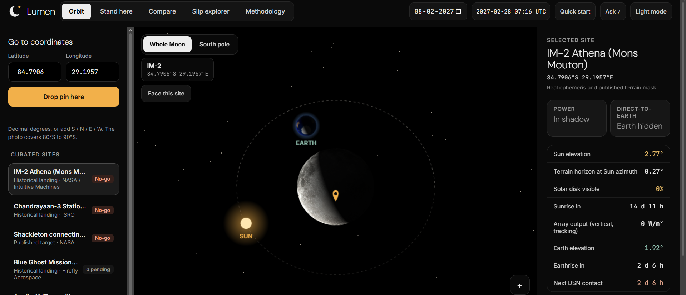
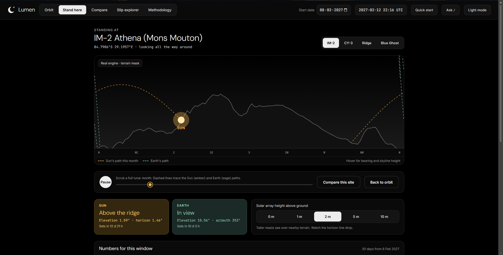
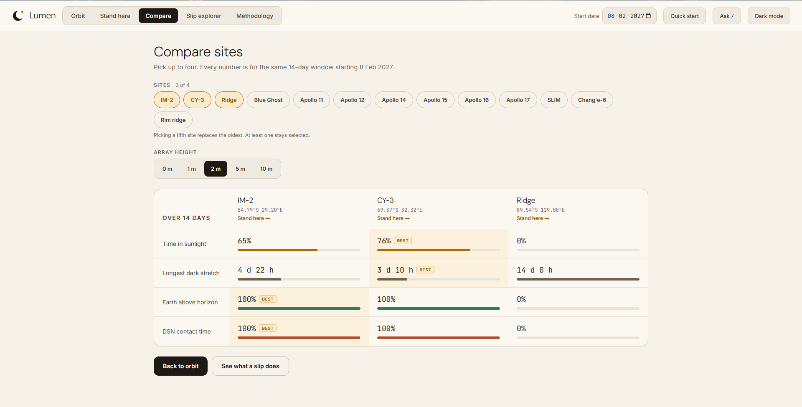
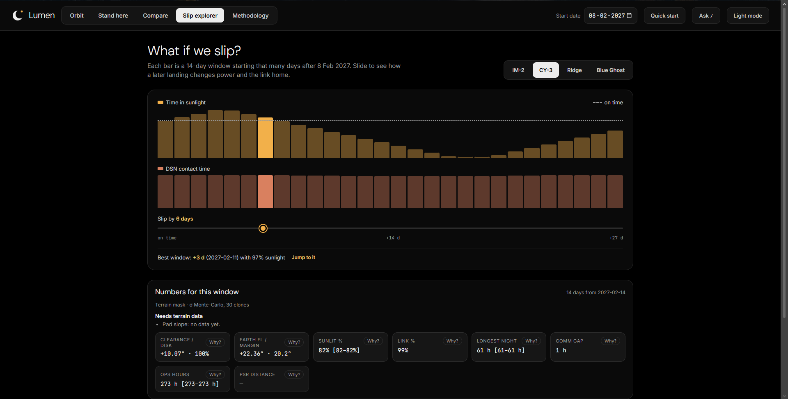

# LUMEN · Lunar Mission ENvironment Navigator

**When is the Sun up, when is Earth in view, and how sure are we?** LUMEN answers that for places on the Moon, with a focus on the south pole, where the Sun skims the
horizon and a ridge a fraction of a degree too tall can hide it for days.

It computes Sun and Earth positions from NASA SPICE ephemeris data, compares them with horizon masks built from NASA LRO LOLA elevation models, and shows the result as a
3D Moon, a real-terrain panorama, a table of every Sun / Earth / link window, Deep Space Network visibility, a "what if we slip?" explorer and a side-by-side site comparison.
It runs entirely in the browser (an offline-capable PWA, no server), and it says plainly where a number has an uncertainty and where it does not.

**Live app:** https://lumen.dhack.in

## The app

| | |
|---|---|
|  |  |
| **Orbit.** The Moon, Sun and Earth for a chosen date, a south-pole view with real cast shadows, a coordinate box to drop a pin, and the curated sites with a verdict tag each (Go / Marginal / No-go, "σ unavailable" or "No terrain data"). | **Stand here.** The skyline from a site, drawn from its real terrain mask, with the Sun's and Earth's paths for the month, a Play / scrub bar, and the engine's numbers for the window. |
|  |  |
| **Compare.** Up to four sites over the same 14-day window: time in sunlight, longest dark stretch, Earth above the horizon and DSN contact. (The "Ridge" column is the older Shackleton row, whose catalogue coordinates sit in permanent shadow, so it reads 0% sunlit.) | **Slip explorer.** What a later landing does to sunlight and DSN contact: slide the slip from 0 to 27 days and see the best window. |

Also in the app:

- **Stand here → Details.** A Windows Table (every Sun, Earth, link and operating window with start and end times, duration and peak elevation, exportable as CSV or JSON), Pointing & link (Earth range, one-way light time, Goldstone / Canberra / Madrid lanes) and Power & barcode (a power curve with a ±σ band and a day-by-day survival barcode). Hovering or clicking a chart moves the shared clock.
- **Start date.** Every page's window follows the chosen UTC day, from 2 Jan 2023 to 31 Oct 2030. It resets to 8 Feb 2027 on reload.
- **Ask LUMEN** (press `/`). An offline helper: it can go to a page, pick a site or set a slip, and it explains any number ("Why?") from the live result and the project's own written material. It is search and templates, not a language model, and says so when it has no answer.
- **Quick start.** Four guided scenarios that set the site, array height and slip for you, with credited imagery.
- **Methodology.** The scope statement, how a number is produced, data sources with links, definitions and frames, how the ± is calculated, and a glossary.
- **Dark and light themes**, and it works offline after the first load.

## How a number is produced

1. **Ahead of time (Python, `pipeline/`).** SPICE kernels (DE421) give the Sun's and Earth's positions in a Moon-fixed frame; LOLA elevation models become per-site **horizon masks** (0.1° azimuth bins, array heights of 1, 2, 5 and 10 m, 250 km range); a Monte-Carlo run perturbs the elevation model within its published error to give an uncertainty (σ) where one exists; DSN station kernels give the Moon elevation of Goldstone, Canberra and Madrid.
2. **In the browser (TypeScript, `web/`, in a Web Worker).** Cubic-Hermite interpolation of the positions, a rotation into the site frame, a mask look-up, disk visibility by chord quadrature, bisection to about 10 s for events, run-length windows, and three-pass bounds when σ exists.
3. **Parity.** The browser engine is compared with the Python reference on shared "golden" test cases.

## Data

All numbers come from the files in `web/public/data/`; nothing is typed in by hand.

| Data | Source |
|---|---|
| Ephemeris, frames | NASA NAIF SPICE (DE421), cross-checked against JPL Horizons and Skyfield |
| Terrain near the pole (fine masks: IM-2, Chandrayaan-3, Shackleton ridge sites) | LRO LOLA elevation models from the NASA Planetary Geodesy Data Archive (5–60 m) |
| Terrain elsewhere (coarse masks: Apollo 11/12/14/15/16/17, SLIM, Chang'e-6, Blue Ghost) | NASA PDS global LOLA elevation model LDEM_128 (about 237 m per pixel) |
| Illumination checks | PGDA average-solar-illumination and slope maps (Mazarico et al. 2011) |
| Site coordinates | Each row cites its source (NASA NSSDC and LROC tables, LROC image pages, ISRO, USGS) in `pipeline/config/sites.yaml` |
| Imagery | NASA SDO, EPIC, LROC and SVS, with credits; no NASA logo or insignia is used |

Full citations: [`docs/data_sources_terrain.md`](docs/data_sources_terrain.md), [`docs/credits_frontend.md`](docs/credits_frontend.md).

The catalogue has **13 sites**. All 13 have a terrain mask: 4 fine (5–60 m) and 9 coarse (about 237 m, labelled "coarse" in the app, so sunrise and sunset there are approximate). Uncertainty (σ) exists for 4 sites (IM-2, Chandrayaan-3, two Shackleton ridge sites) and is preliminary; the 9 coarse-mask sites show "σ unavailable" because NASA publishes no error raster for the global model they use. A pin dropped outside a mask uses a smooth-Moon estimate and is labelled as one; inside the south-polar map it takes its lit / shadow state from the map.

## Validation, stated plainly

The validation report ([`web/public/data/validation/report.json`](web/public/data/validation/report.json)) records each gate's real status. A gate is PASS only when a recorded check meets its criterion. **Overall status: NOT READY.**

- **9 of 13 gates pass:** frame transformations, interpolation vs SPICE, geometry vs JPL Horizons, DSN elevation vs Horizons, the raycaster vs analytic terrain, browser-vs-Python parity, pad slope vs NASA slope maps, and Windows Table / barcode / CSV integrity, and Chandrayaan-3 (G7): LUMEN gives 8.61° of Sun elevation at touchdown against the 8.75° the project director reported to the Times of India (2 Sep 2023), within the ±0.25° tolerance, and the Sun drops below his 6° operations minimum on 3 Sep, the day ISRO began putting the lander and rover to sleep.
- **1 fails (G5):** multi-year sunlight vs NASA's illumination map agrees within 0.6 points at IM-2, Chandrayaan-3 and the old Shackleton row, but at the new Shackleton–de Gerlache ridge site the mask gives 39% against NASA's 78%. Diagnostics ruled out a single-pixel effect (LUMEN is ~25 points lower at all nine map pixels around the site) and terrain resolution (coarser terrain makes LUMEN darker, not brighter); the remaining, untested hypothesis is a horizontal offset of this knife-edge crest between the 2016 map's terrain and the 2023 re-adjusted terrain LUMEN uses.
- **3 are open:** timing on the demo laptop (measured on an unconfirmed machine: Stand here now shows numbers in ~160 ms and the ± and verdict in ~390 ms, both over the 100 ms budget), predicted shadows vs a LROC image (evidence produced — shadows cast on LROC's 3 m DTM of the Chandrayaan-3 area land on the photo's shadows, and LUMEN's Sun matches LROC's incidence angle to 0.005° — awaiting a human visual sign-off), and Tier-B uncertainty calibration.

## Scope and known limits

LUMEN computes **geometric** Sun and Earth availability, DSN coverage and a generic power estimate. It does **not** compute link budgets, data rates, thermal survival or vehicle-specific array performance. The elevation model bounds the near-field horizon; lander-scale rocks are not modelled; DSN visibility uses one elevation threshold. No claim is made about any mission's status or schedule.

Not done yet: the Tier-B regional terrain grid for custom points near the pole, a measured σ for the nine coarse-mask sites (theirs assumes a constant 1 m error), the Artemis candidate regions in the catalogue, and a free-form date range. Details: [`docs/limitations.md`](docs/limitations.md).

## Repository layout

- `pipeline/` — Python 3.12 build-time pipeline (ephemeris, DSN, terrain, catalogue, validation).
- `web/` — React + Vite + TypeScript static offline PWA.
- `contracts/` — frozen data and API contracts (source of truth for file formats and hooks).
- `docs/` — validation, data sources, limitations, architecture, the submission write-up.
- `plan/` — the locked master plan and work-distribution documents (read-only reference).

Ownership of every path is enforced by `CODEOWNERS`; see `plan/WORK_DISTRIBUTION (1).md` §1–§3 before editing anything outside your own section.

## Getting started

### Frontend (`web/`)

```
cd web
npm install
npm run dev            # http://localhost:5173 (real data by default; VITE_LUMEN_DATA=mock for sample values)
npm test               # Vitest unit tests
npm run e2e:install    # once: Playwright Chromium
npm run e2e            # the four live pages × 5 viewports (loads, no errors, no horizontal scroll) + routing, theme, slip, Ask, Quick-start, Methodology
npm run e2e:real       # real-data checks on the live pages (Stand here Details, Ask LUMEN, Start date, polar pins)
npm run lint && npm run typecheck
```

Layout, slot ids, density modes and the hot-path rules for teammates: [`docs/ui_guide.md`](docs/ui_guide.md).

### Backend (`pipeline/`)

```
cd pipeline
pip install -e ".[dev]"
# NASA NAIF SPICE kernels (git-ignored; the same files CI downloads in .github/workflows/ci-backend.yml)
mkdir -p kernels && cd kernels
N=https://naif.jpl.nasa.gov/pub/naif
curl -fLO $N/generic_kernels/lsk/naif0012.tls
curl -fLO $N/generic_kernels/pck/pck00011.tpc
curl -fLO $N/MAVEN/kernels/spk/de421.bsp      # also at generic_kernels/spk/planets/a_old_versions/
curl -fLO $N/generic_kernels/pck/moon_pa_de421_1900-2050.bpc
curl -fLO $N/generic_kernels/fk/satellites/moon_080317.tf
cd .. && ruff check . && pytest
```

The published data under `web/public/data/` is produced by the scripts in `pipeline/scripts/`:

| Script | Produces |
|---|---|
| `run_ephem.py`, `run_dsn.py` | Sun / Earth positions, DSN station elevations |
| `run_catalog.py` | `catalog/sites.json` from `config/sites.yaml` |
| `run_masks.py`, `run_masks_global.py` | Terrain masks (polar products, and the global model for non-polar sites) |
| `run_pad.py`, `run_pad_lroc.py`, `run_dispersion.py` | Pad slope (polar DEMs; LROC NAC DTMs for Apollo and Chang'e-6) and the 11 × 11 dispersion grids |
| (σ) | Monte-Carlo uncertainty is described in [`MC_SIGMA_REPORT.md`](MC_SIGMA_REPORT.md); `run_mc_sigma_site.py` (error-raster sites) and `run_mc_sigma_coarse.py` (assumed-error, coarse-mask sites) generate a site's σ file (`run_mc_sigma.py` is a stub) |
| `record_ts_evidence.py`, `run_g5.py`, `g5_pixel_comparison.py`, `run_g6.py`, `run_g7_timeline.py`, `run_g9.py` | Validation evidence under `pipeline/reports/` |

The terrain scripts download elevation windows from NASA archives and cache them in `pipeline/cache/` (not committed).

### Build, deploy and offline

```
npm run build                                          # production build + service worker (app shell and data are precached), served from the site root
VITE_BASE=/Lumen/ VITE_LUMEN_DATA=real npm run build   # for hosting under a sub-path such as https://<user>.github.io/Lumen/
npm run preview                                        # serve dist/
```

The app is a static site (`web/dist/`), so any static host works. It is served from the root of https://lumen.dhack.in, which uses the default base path `/`. `.github/workflows/deploy.yml` is an optional alternative that publishes `main` to GitHub Pages under a sub-path (it needs Settings → Pages → Source "GitHub Actions"). Data files under `web/public/data*` are Git LFS objects, so check out with LFS. After the first load the app works with the network off.


